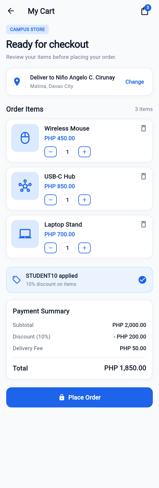
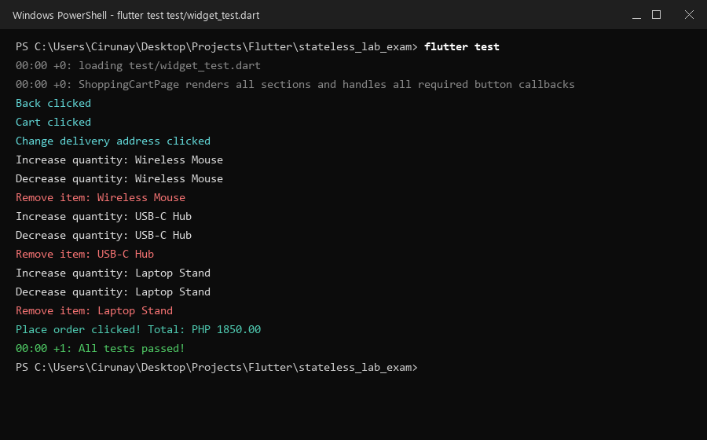

# Shopping Cart Page — Flutter StatelessWidget Laboratory Exam

A Flutter shopping cart user interface built entirely using the **`StatelessWidget`** paradigm, replicating a clean modern e-commerce mobile design.

## Student Information
- **Student Name:** Niño Angelo C. Cirunay
- **Delivery Address:** Matina, Davao City
- **Project Name:** `stateless_lab_exam`
- **GitHub Repository:** [https://github.com/CirunayN/LAB-EXAM-1.git](https://github.com/CirunayN/LAB-EXAM-1.git)

---

## Output Screenshots

| Complete Interface (`output_1.png`) | Console Callbacks (`console_output.png`) |
| :---: | :---: |
|  |  |

---

## Interface Sections

1. **AppBar**
   - Back-arrow `IconButton` on the left (`debugPrint('Back clicked')`).
   - Title: **"My Cart"** in bold slate typography.
   - Shopping bag icon with a notification badge displaying **3** positioned using a `Stack` (`debugPrint('Cart clicked')`).

2. **Introduction Section**
   - **`CAMPUS STORE`** badge inside a light-blue rounded container.
   - Large bold heading: **`Ready for checkout`**.
   - Subtitle: *`Review your items before placing your order.`*

3. **Delivery Information Card**
   - Rounded white card with location icon (`Icons.location_on`).
   - Deliver to: **`Niño Angelo C. Cirunay`**.
   - Subtext: *`Matina, Davao City`*.
   - **`Change`** text button on the right (`debugPrint('Change delivery address clicked')`).

4. **Order Items Section**
   - Section header: **`Order Items`** aligned with **`3 items`**.
   - Three product cards created using the reusable **`CartItemCard`** widget:
     - **Wireless Mouse** — PHP 450.00 (Quantity: 1)
     - **USB-C Hub** — PHP 850.00 (Quantity: 1)
     - **Laptop Stand** — PHP 700.00 (Quantity: 1)
   - Each card features:
     - Material icon in a light-blue rounded container.
     - Product name in bold.
     - Price highlighted in blue.
     - Delete icon button (`debugPrint('Remove item: [product name]')`).
     - Quantity stepper with minus button, quantity text box, and plus button (`debugPrint('Decrease quantity: [product name]')`, `debugPrint('Increase quantity: [product name]')`).

5. **Discount Banner**
   - Light-blue rounded container with a discount tag icon (`Icons.local_offer_outlined`).
   - Title: **`STUDENT10 applied`**.
   - Subtitle: *`10% discount on items`*.
   - Check-circle indicator (`Icons.check_circle`) on the right.

6. **Payment Summary Card**
   - White rounded card with heading **`Payment Summary`**.
   - Aligned rows:
     - **Subtotal:** PHP 2,000.00
     - **Discount (10%):** - PHP 200.00
     - **Delivery Fee:** PHP 50.00
     - *Divider*
     - **Total:** **PHP 1,850.00** (bold emphasis)

7. **Place Order Button**
   - Full-width vibrant blue button with rounded corners (`BorderRadius.circular(14.0)`).
   - Lock icon (`Icons.lock`) and **`Place Order`** label.
   - Callback: `debugPrint('Place order clicked! Total: PHP 1850.00')`.

---

## Required Button Console Messages

| Control | Console Output Message |
| :--- | :--- |
| **Back arrow** | `Back clicked` |
| **Shopping bag** | `Cart clicked` |
| **Change button** | `Change delivery address clicked` |
| **Plus button (+)** | `Increase quantity: [product name]` |
| **Minus button (&minus;)** | `Decrease quantity: [product name]` |
| **Delete button** | `Remove item: [product name]` |
| **Place Order button** | `Place order clicked! Total: PHP 1850.00` |

---

## Reusable `CartItemCard` Widget

Implemented in `lib/shopping_cart_page.dart` with constructor parameters:

```dart
class CartItemCard extends StatelessWidget {
  final String productName;
  final String price;
  final int quantity;
  final IconData icon;

  const CartItemCard({
    super.key,
    required this.productName,
    required this.price,
    required this.quantity,
    required this.icon,
  });
  // ...
}
```

---

## Project Structure & Submission Files

```text
stateless_lab_exam/
├── lib/
│   ├── main.dart
│   └── shopping_cart_page.dart
├── submission/
│   ├── main.dart
│   ├── shopping_cart_page.dart
│   ├── output_1.png
│   ├── output_2.png
│   ├── console_output.png
│   └── stateless_lab_exam_documentation.pdf
├── test/
│   └── widget_test.dart
├── output_1.png
├── output_2.png
├── console_output.png
├── stateless_lab_exam_documentation.pdf
├── pubspec.yaml
└── README.md
```

---

## How to Run the Project

1. Ensure Flutter is installed and available in your environment:
   ```bash
   flutter doctor
   ```
2. Get project dependencies:
   ```bash
   flutter pub get
   ```
3. Run widget tests to verify all 7 sections and callbacks:
   ```bash
   flutter test
   ```
4. Run the application on your desired device:
   ```bash
   flutter run
   ```
